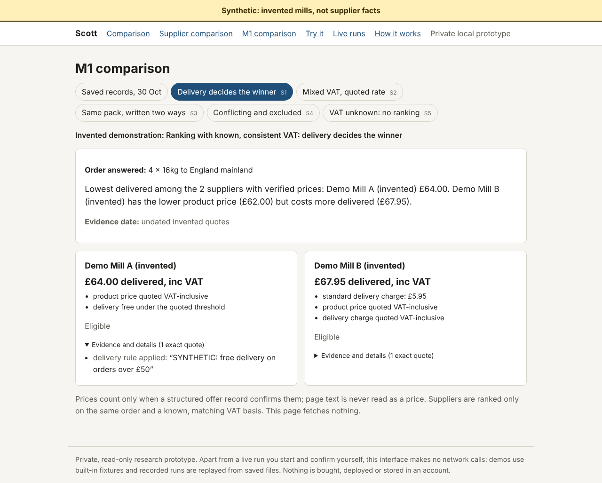
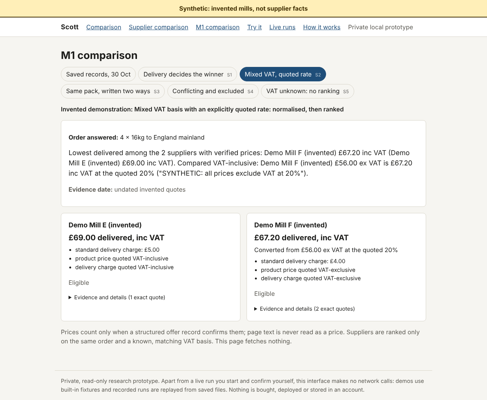
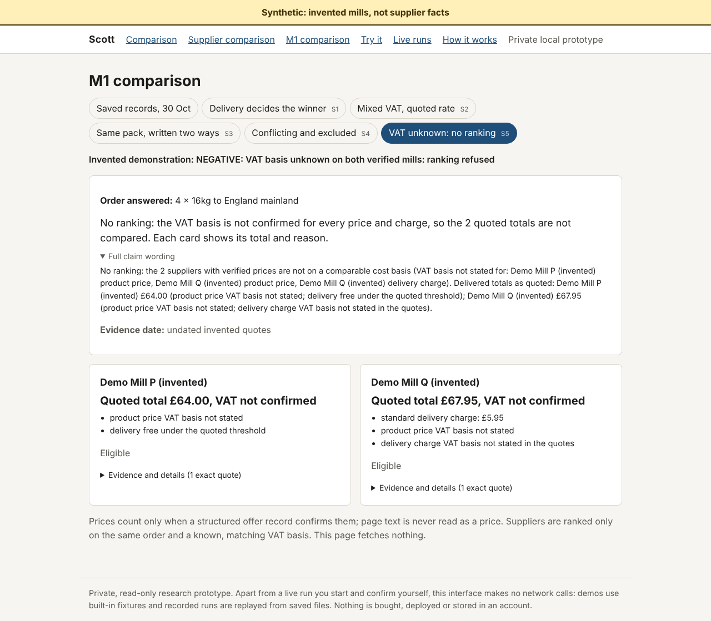
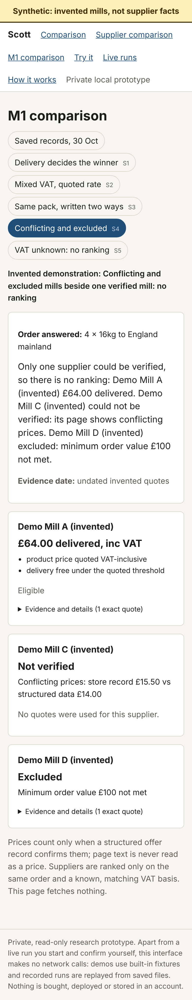

# Scott: delivered-cost comparison (MVP prototype)

> **Status:** MVP prototype for fixed example orders, built on invented demo data. It makes no live supplier calls unless you enable the optional live connector, which is disabled by default. The offline test suite and the documented demo commands pass from a fresh install; the two browser tests need Playwright's Chromium and were skipped in that fresh run. See "Scope of these checks" below.

Scott is an MVP prototype that compares the **delivered cost of one fixed order** across suppliers. It **refuses to
rank** when the evidence does not support a ranking. The demo uses **invented suppliers only**: it shows fixed example
orders, with no live prices and no form for arbitrary orders.

## Screenshots

| | |
|---|---|
|  |  |
| *Ranking with known, consistent VAT: the delivery charge decides the winner.* | *Mixed VAT basis, converted only at the quoted 20%.* |
|  |  |
| *VAT basis not confirmed: totals shown, no ranking.* | *Conflicting prices and an unmet minimum order, at phone width.* |

Every screen shows invented mills on reserved `.example` addresses, under the banner "Synthetic: invented mills, not
supplier facts".

**Video:** [Download the walkthrough (mp4, 3.2 MB)](https://raw.githubusercontent.com/themojtabajaveed/scott-supplier-comparison/main/docs/video/scott-m1-walkthrough.mp4), file `docs/video/scott-m1-walkthrough.mp4`. GitHub does not play it inline. It is a 106-second guided
walkthrough (1280×830, no audio) of the demo page.
- Each scenario opens on the top of the page, with the heading and the active scenario chip, then scrolls down to the
  claim, the cards and, for S1, the opened evidence.
- Captions sit in a band below the page, so they never cover it.
- The walkthrough ends with a phone-width (390px) part.
- The storyboard, with every caption, is [STORYBOARD-DEMO.md](STORYBOARD-DEMO.md).

## Quickstart

[START-HERE.md](START-HERE.md) has the shortest path, with each demo command explained. In short:

```
python3 -m venv .venv
source .venv/bin/activate            # Windows: .venv\Scripts\activate
python -m pip install -r requirements.txt
python -m pytest -q                  # expected on Python 3.13: 505 passed, 2 skipped
python -S scripts/scout_ui_demo.py   # then open http://127.0.0.1:8017/m1
```

## How it works (architecture and data flow)

```
order (fixed: pack, quantity, destination)
   │
   ▼
offer screen (scout/engine/offers.py) ── structured offer records only (JSON-LD, store records, page script data)
   │                                      bound to the configured product, SKU and pack; page text is never a price
   ▼
comparison layer (scout/engine/supplier_comparison.py)
   │  eligibility: availability, pack, geography, minimum order
   │  delivery: quoted thresholds (over/from), standard and per-parcel charges, exclusions; abstains on unknowns
   │  comparability: same order need, and a known, matching VAT basis (mixed bases only with a quoted rate)
   ▼
verdict + one summary sentence that says only what the evidence shown supports, with each supplier's total and reason
   │
   ▼
views: scripts/compare_offline.py (markdown/JSON) · /m1 in the local UI (scout/m1_view.py)
```

- **Fails closed.** An unverifiable price, a conflicting charge, a missing zone, an unstated parcel count or a currency
  mismatch makes the layer abstain rather than guess. Abstentions and exclusions are named in the claim. With only one
  verified supplier, there is no ranking.
- **Demo mode.** The demo uses its own named configuration (`scout/workflows/demo_supplier.py`, `scout/demo_mode.py`)
  and invented data under `demo/`. Sample runs (`scripts/scout_question.py --demo`, the bundled `demo-supplier/` and
  `demo-provider/` outputs) use invented identities on `.sample.example` addresses.
- **Live connector.** It is separate and disabled by default (see "Live connector" below). Its configuration
  (`scout/workflows/supplier.py`) lists the public supplier pages it may read. The demo never reads them.

## Set up

**Python 3.13** is the supported version: CI uses it (`.github/workflows/ci.yml`), and so do the default test results
below.

**1. Core (offline demo and tests).** `requirements.txt` holds pytest and PyYAML:

```
python3 -m venv .venv
source .venv/bin/activate            # Windows: .venv\Scripts\activate
python -m pip install -r requirements.txt
```

**2. Optional browser extra.** `requirements-live.txt` adds `playwright` to the core requirements, unpinned. Playwright
also needs its Chromium build:

```
python -m pip install -r requirements-live.txt
python -m playwright install chromium
```

The browser extra is needed only for the two browser tests (they skip without it) and for the live connector. The
browser tests were run with Playwright 1.47.0. That version depends on greenlet 3.0.3, which has no Python 3.13 build,
so that run used a separate Python 3.12 environment:

```
python3.12 -m venv .venv-browser
source .venv-browser/bin/activate
python -m pip install -r requirements.txt playwright==1.47.0
python -m playwright install chromium
python -m pytest -q
```

## Verification

| Environment | Result |
|---|---|
| Python 3.13, `requirements.txt` | **505 passed, 2 skipped** (the 2 browser tests skip without Playwright) |
| Python 3.12, Playwright 1.47.0, Chromium 129 (build 1134) | **507 passed, 0 skipped** |

- **Request blocking in a real browser.**
  `tests/test_network_integration.py::test_chromium_blocks_post_and_redirect_before_server_receives` runs the product's
  own Python request handler (`scout/engine/browser.py`) in Chromium against a local server. A POST and a redirect
  target never reach the server.
  - **Negative control:** with the request-allow decision forced to allow everything, the same test fails, because the
    POST reaches the server.
- **Layout.** `tests/test_home_layout.py::test_home_table_reads_fully_at_desktop_and_phone_widths` checks the home table
  in Chromium at desktop and phone widths.
- **Contract derivation.** The 23-case contract and the 10-case adversarial set are synthetic derivatives. A check
  that uses no engine code covers all 33 cases ([tests/COMPARISON-DERIVATION.md](tests/COMPARISON-DERIVATION.md)).
- **Scope of these checks.** The counts above come from the development environment. A separate clean-install run on
  26 November 2026 (new virtual environment from a fresh unzip, Python 3.13.18, PyYAML 6.0.4, pytest 9.2.0 with their
  current dependencies, resolved from the unpinned `requirements.txt`) also gave `505 passed, 2 skipped`, and every
  command in `START-HERE.md` ran. The browser tests were not part of that run. The Python 3.13 combination with
  Playwright is untested.

More detail is in [docs/TESTING.md](docs/TESTING.md).

## Live connector (disabled by default)

The full local UI (`python -S scripts/scout_ui.py`) binds to 127.0.0.1 and fetches nothing on its own. A live run of one
configured public supplier page is a deliberate manual action, and it is refused unless all of these hold:
- an API key is set in the server's own environment;
- a project setting is in a local `scott.local.json`, copied from `scott.local.example.json` and never committed;
- Playwright is installed;
- a usage ledger file exists. A missing, unreadable or invalid ledger refuses every live run, and this repository
  includes none.

Its limits are set in code, in `scout/live_run.py`: a per-run call cap (`UI_RUN_CALL_CAP`) and cumulative call and
token caps (`CUMULATIVE_CAPS`). A run that could exceed them is refused before any model call. These are local
counters: they do not show what a provider bills.

## Limitations

- No live prices: every comparison shown uses invented data.
- Fixed example orders only; there is no form for arbitrary orders.
- No purchasing and no cheapest-buy or best-model advice.
- A single live run would not be evidence of reliability.
- The "Saved records, 30 Oct" tab and some test comments refer to real recorded runs. Those runs, and the third-party
  page text they contain, are not included in this repository.

## Provenance and licence

- **Provenance.** The tests and demos use invented fixtures and documented synthetic derivatives. No third-party page
  text, real supplier prices or real recorded evidence are included.
- **Licence:** MIT, see [LICENSE](LICENSE).
- **How it was built:** Scott was built with AI coding assistants (Claude Code). The tests in this repository check its behaviour.
